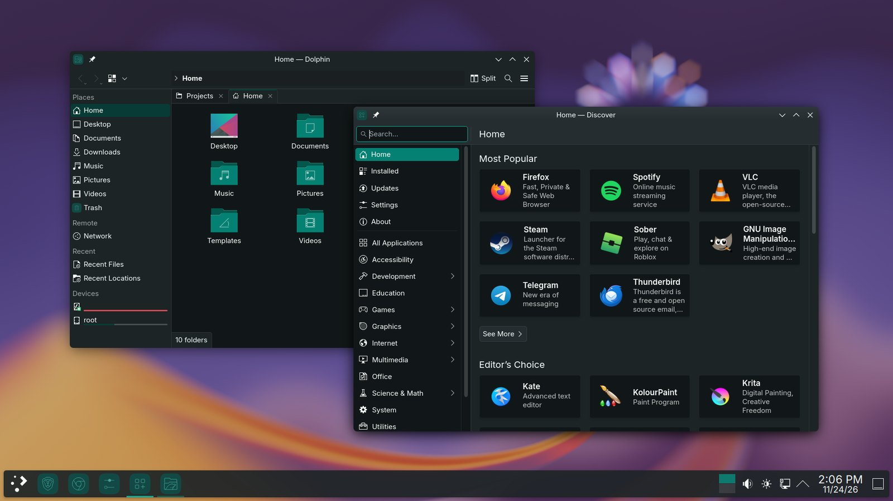
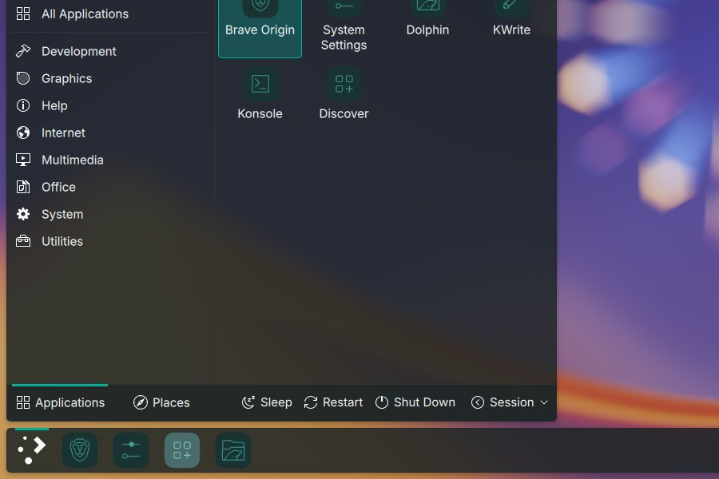
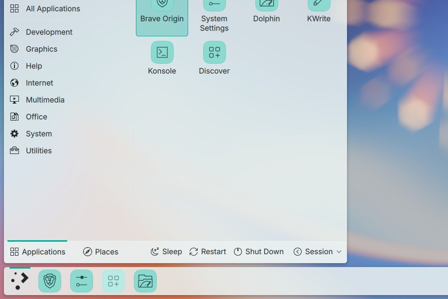
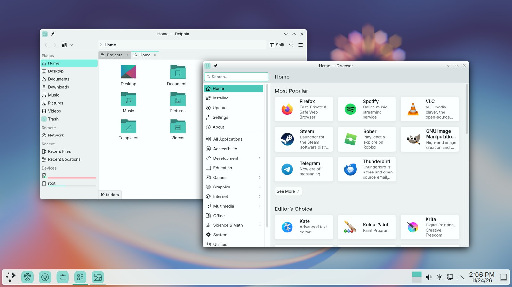
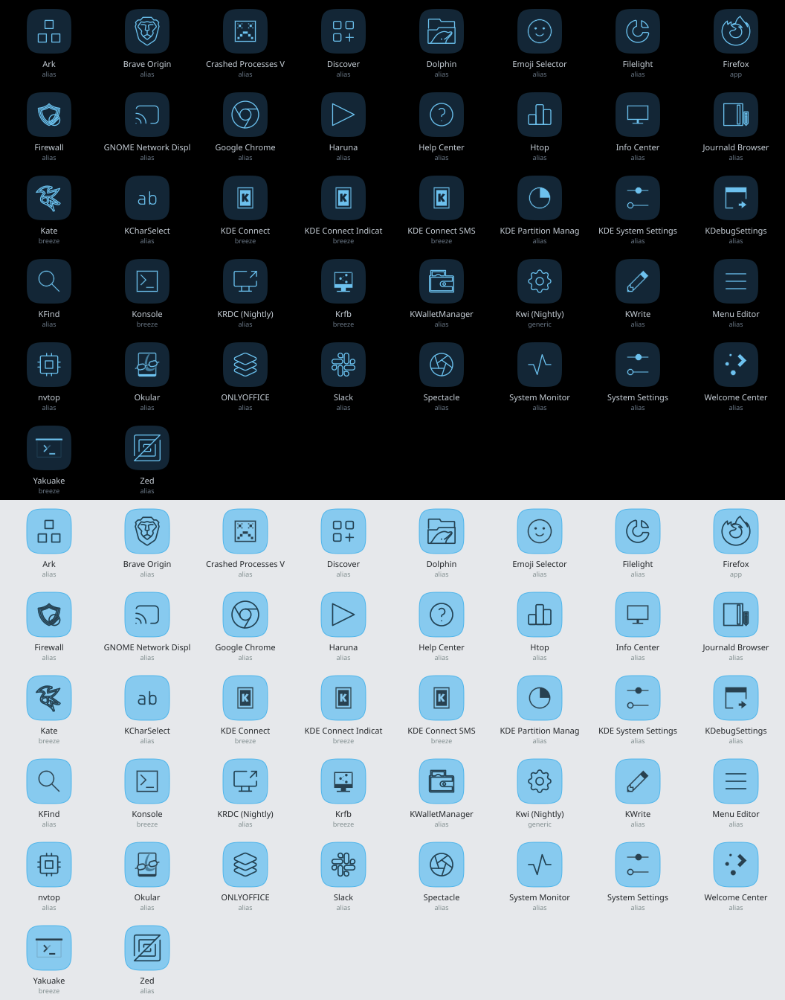

# Katze OS

A personal desktop operating system, built as code: Fedora Kinoite (KDE Plasma) turned into an immutable image, with its own look and the tools its owner works with.



Every machine runs the same image, and nothing is installed on a machine by hand. A change is a commit in this repository; GitHub Actions builds the image every day, tests it, signs it and publishes it to `ghcr.io/ysantalla`, and each machine downloads it in the background and applies it on the next restart. If an update goes wrong, one command goes back to the previous version.

It is built with [bootc](https://bootc-dev.github.io/bootc/), on top of [Universal Blue](https://universal-blue.org/)'s `kinoite-main`.

## What it looks like

Katze comes with two global themes, **Katze Dark** (the default) and **Katze Light**. The Dark Mode switch in the panel goes from one to the other.

| Katze Dark | Katze Light |
|---|---|
|  |  |



- **Katze Mono icons.** Each application gets a thin line glyph on a rounded shape, drawn for it when the image is built: the application's own mark where it has one, a line glyph for what it does otherwise. Icons and shapes take the accent color you choose in System Settings.
- **One panel,** 56 px thick, with the virtual desktop switcher next to the tray and tray icons that scale with it.
- **Colors that follow you.** The panel, the launcher and the icons use the color scheme and its accent, in light and in dark.
- **Inter** for the interface, with no sub-pixel text, since OLED panels often lack RGB stripes.



## What is in it

- **A full KDE Plasma desktop** with video codecs, from `kinoite-main`.
- **Browsers:** Brave Origin and Google Chrome, as native packages.
- **Development without touching the system:** Incus for containers and virtual machines, and `docker` and `docker compose` running on rootless Podman. Compilers and project tools live in containers, not in the image.
- **A terminal ready to use:** zsh with suggestions and highlighting, a Starship prompt, a Nerd Font, Konsole and a drop-down Yakuake on F12.
- **Apps:** Okular, Haruna, and Zed, Slack and ONLYOFFICE as Flatpaks.
- **A private network** between your devices with Tailscale, and a firewall that keeps development ports closed on networks you do not trust.
- **Updates you do not manage:** downloaded every six hours on AC power, announced on the desktop, applied when you restart, and signed.

## The images

| Image | FROM | What it adds |
|---|---|---|
| `base` | `ghcr.io/ublue-os/kinoite-main:45` | Everything above. Hardware-agnostic. Codecs and Podman come from kinoite-main. No Docker engine, no libvirt, no Toolbx or Distrobox |
| `xps16-da16260` | `ghcr.io/ysantalla/base:45` | Dell XPS 16 (2026) DA16260: Intel video flags for the browser launchers, a pinned VA-API driver for the Arc B390, fixes for thermald and Dell's power profiles, tools to measure battery, temperature and GPU use, the internal camera through PipeWire, voice dictation in Spanish on the NPU or the GPU, and face unlock on the lock screen with the infrared camera |

Each machine gets its own image named after its model, containing only what that hardware needs.

It is one person's setup, published so that it can be read and copied from, not a distribution: there is no installer of its own and no support. `CLAUDE.md` explains how it is built, `docs/status/` what has and has not been tested, and `docs/xps16-plan.md` the plan for the XPS.

## What base includes

| Component | How |
|---|---|
| KDE Plasma, codecs (ffmpeg), Podman | From `kinoite-main` |
| Incus | System containers and VMs (`--vm`), with QEMU and a firewalld zone for `incusbr0`: instances reach the internet, but not the host's ports. `incus.socket` enabled; group and subuid set up at boot |
| Brave Origin | Official RPM (`brave-origin`), no Rewards/Wallet/VPN/AI. Installed in `/usr/lib/brave.com`, linked to `/opt` via `tmpfiles.d` |
| Google Chrome | Official RPM, for video calls. Installed in `/usr/lib/google`, linked to `/opt` via `tmpfiles.d` |
| Browser defaults | Both browsers pick Wayland on their own. `xps16-da16260` adds Intel video flags to the menu launchers, which terminal launches and installed web apps do not get. The system title bar and Qt colors are first-run preferences, so existing profiles keep their settings |
| Docker commands | `docker` and `docker compose` run on rootless Podman, through `podman-docker` and the real Compose. There is no Docker engine, and images and volumes from Docker are not carried over |
| Katze theme | Two global themes, Katze Dark (the default for new users) and Katze Light: their own colors, a Plasma style with custom taskbar indicators, Katze Mono icons that follow the accent color, and a 56 px panel. Settings already in `~/.config` keep their choice |
| Interface fonts | Inter 11 across KDE, with no sub-pixel text. Noto stays the system sans-serif, and settings already in `~/.config` keep their choice |
| Okular | Native PDF and document viewer |
| Haruna | KDE video player, native, using the image's full ffmpeg (H.264, HEVC, VP9, AV1, DTS and more) and VA-API |
| Office fonts | Carlito and Caladea stand in for Calibri and Cambria with the same metrics, and Liberation covers Arial, Times New Roman and Courier New. Microsoft's own fonts are not in this public image: if you need them, copy them to `~/.local/share/fonts` on each machine and check your license |
| Terminal | zsh, Starship with a Powerlevel10k-style prompt, MesloLGS Nerd Font, Konsole profile, Yakuake (F12) and `fastfetch`. Personal settings go in `~/.zshrc`, and `~/.config/starship.toml` replaces the factory prompt |
| Tailscale | Private network between your devices. `tailscaled` is enabled; run `sudo tailscale up` once to log in |
| Flatpaks | Zed, Slack, ONLYOFFICE and GNOME Network Displays. List in `flatpaks.list`. Slack and ONLYOFFICE get custom launchers and overrides. Zed uses KDE's window borders; to undo it, remove `/var/lib/flatpak/overrides/dev.zed.Zed` |
| Updates | `katze-update.timer`: downloads every ~6 h (on AC and non-metered connections only, catching up after suspend), applied on reboot. A desktop notification says when one is ready, and another warns if the running image is over 14 days old |

## Layout

```
.github/
  workflows/build.yml        lint → base → xps16-da16260 (daily, on push, manual)
  workflows/reusable-build.yml  verify the FROM image + build + test + push to GHCR + cosign signature and verify
  workflows/module.yml       the XPS's infrared camera driver: build without secrets, then sign
  workflows/pins.yml         weekly: an issue when a pinned download has a newer release
  workflows/kernel-watch.yml weekly: an issue when the kernel or Fedora moves on something the XPS waits for
  workflows/prune.yml        weekly: delete builds older than a month from GHCR
  scripts/                   prune-registry.py, sign-module.py
  keys/ublue-os.pub          Universal Blue's public key, to verify kinoite-main
tests/
  smoke.sh                   checks each built image from the inside, before it is published
  check-pins.sh              what pins.yml runs
  check-kernel.sh            what kernel-watch.yml runs
  theme-screenshots.sh       what mise run theme:screenshots runs
  xps16-vrr.sh               on the XPS: one boot with VRR through an edited EDID, and its checks
images/
  base/
    Containerfile
    build_files/             build-time only, not shipped in the image
      build.sh               packages, browsers, terminal, Katze theme, services, font cache
      brave.sh               Brave Origin + /opt workaround
      chrome.sh              Google Chrome + /opt workaround
      browsers.sh            first-run browser preferences
      signing.sh             signature policy: our registry only with our signature
      shell.sh               Starship, Nerd Font and terminal defaults
      plasma-theme.sh        Katze Dark as the default, Katze Mono icons, fonts
      tailscale.sh           Tailscale from its official repo
      packages.txt           Incus, QEMU, zsh, Yakuake, fastfetch, Okular, Haruna, fonts, Docker commands
    system_files/            copied as-is to / in the image
      usr/libexec/katze/           setup.sh, flatpaks.sh, update-*.sh, image-age.sh, desktop-entries.sh, icons.sh, katze-mono.py
      usr/lib/systemd/system/          katze-* services and timer
      usr/lib/systemd/user/            update notification, old image warning, Flatpak launchers, Katze Mono icons
      usr/lib/tmpfiles.d/              katze-brave.conf, katze-chrome.conf, katze-flatpak-overrides.conf
      usr/lib/environment.d/           60-katze-docker-host.conf
      usr/lib/firewalld/zones/         katze-incus.xml, katze-laptop.xml, katze-tailscale.xml
      usr/lib/firewalld/policies/      katze-incus-out.xml, katze-incus-private.xml
      usr/share/katze/          flatpaks.list, zshrc, starship.toml, applications/, cosign.pub
      usr/share/containers/containers.conf.d/ 60-katze-compose.conf
      usr/share/konsole/               katze.profile
      usr/share/plasma/desktoptheme/   katze (Plasma style)
      usr/share/plasma/look-and-feel/  katze-dark, katze-light (global themes)
      usr/share/color-schemes/         KatzeDark.colors, KatzeLight.colors
      usr/share/katze/katze-mono/      choices and glyphs of the Katze Mono icons
  xps16-da16260/
    Containerfile
    build_files/
      build.sh               browser flags, screen timeouts, power profiles, face unlock prompt
      dictation.sh           Voxtype and the OpenVINO GenAI SDK (pinned, sha256)
      hm1092.sh, hm1092/     the infrared camera's driver, built and signed by module.yml
      ir-camera/             the infrared camera's reader, in C
      face/                  face unlock: katze-face and katze-face-check, in C
      packages.txt           libva-intel-media-driver, libva-utils, powertop, lm_sensors, igt-gpu-tools, kernel-tools, intel-npu-driver, intel-opencl
    system_files/usr/
      libexec/katze/         camera.py, dictation-setup.sh, platform-profile.sh, thermald-wait.sh
      lib/systemd/           camera relay, dictation, infrared camera and face unlock units, thermald drop-in
      lib/tuned/profiles/    katze-xps-* power profiles
bib/config.example.toml      user for test VMs
devbox/                      Incus profile and cloud-init for per-project dev containers
docs/                        status/ (what was tested), screenshots, the XPS's plan and checklist, VM viewers, secrets and dev containers
mise.toml                    local tasks + cosign
```

## 1. One-time setup

```bash
mise trust && mise install        # installs cosign for this repo

# Signing key, with a password that only CI needs
cosign generate-key-pair

git init -b main
git add .
git status                        # cosign.pub listed, cosign.key NOT listed
git commit -m "Initial bootc images"

gh repo create ysantalla/katze-os --public --source . --remote origin
gh secret set SIGNING_SECRET < cosign.key
gh secret set COSIGN_PASSWORD        # the password you just chose
git push -u origin main
```

`cosign.key` is git-ignored. CI is the only thing that needs it, so delete it from disk once the secrets are set. If a key is lost or exposed, generate a new pair, update both secrets, and commit the new `cosign.pub` in both places it lives: the repo root and `images/base/system_files/usr/share/katze/`. CI checks that they match. Machines enforcing signatures must already run an image with the new key, or they stop updating until you switch them again.

The repo is public, so GitHub disables the daily schedule after 60 days without repository activity. It warns by email; re-enable the workflow if that happens.

After the first build, check that the images pull without credentials (`skopeo inspect docker://ghcr.io/ysantalla/base:45`). If not, make the `base` and `xps16-da16260` packages **public** in GHCR.

## 2. Test in a VM before touching real hardware

```bash
mise run vm base                   # output/base/qcow2/disk.qcow2
mise run vm xps16-da16260          # builds local base first if missing, then the XPS layer
mise run iso xps16-da16260         # installer ISO
```

`mise run vm` and `mise run iso` need a `bib/config.toml`: copy `bib/config.example.toml` and set your own password.

Test disks are 40 GiB with the current `bib/config.example.toml`. If you already have a `bib/config.toml`, add its `[[customizations.filesystem]]` block by hand, because the file is not updated for you. Change the password there too. A 20 GiB disk fills up with Flatpaks, Incus images and two system versions.

Boot a throwaway copy with QEMU, leaving the built disk untouched, and log in with the user from `bib/config.toml`. The first boot is slow and the screen can stay black for a few minutes. **View → serial0** shows the boot messages meanwhile.

```bash
mise run vm-up xps16-da16260         # boots it, and creates the copy only if it is missing
mise run vm-up xps16-da16260 --gl    # with OpenGL through the host GPU
mise run vm-reset xps16-da16260      # erases the copy, after asking
```

- **Sharp text on a host with fractional scaling:** `vm-up` sets `GDK_BACKEND=x11 GDK_SCALE=1` so the host does not rescale QEMU's window. It needs KDE's XWayland scaling to match the monitor, and the VM stays on Wayland. Set the scale inside the VM to match.
- **Restarting:** use `sudo reboot` and `sudo poweroff` inside the VM. Closing the QEMU window is like pulling the plug.
- **Sound:** `vm-up` plays through the host, with no microphone input.
- **Copying files and text:** run `sudo systemctl enable --now sshd` and `sudo firewall-cmd --add-service=ssh` in the VM (the default firewall zone does not let SSH in, and the second command lasts until the VM restarts), then `ssh -p 2222 yasmany@localhost` and `scp -P 2222` from the host.
- **Updates in the VM:** the disk points at `localhost/<image>:latest`, so `katze-update.service` fails until you run `sudo bootc switch ghcr.io/ysantalla/<image>:latest`.
- **`--gl`:** gives the VM OpenGL for testing GPU compositing, but no Vulkan. It froze the desktop once, with Plasma and KWin using most of the CPU, so leave it off unless you need it. Do not trust the `Video Decode` line in `chrome://gpu` here: nothing shows video really decoding in hardware.
- **On a machine already running the image:** `vm-up` does not work there. Use `mise run vm-incus <image>`, which boots the same disk as the Incus VM `<image>-test`. Enter it with SSH or `incus console`. Its screen needs a viewer: see `docs/vm-viewers.md`. After rebuilding the disk, erase the VM with `incus delete -f <image>-test`.
- **What a VM cannot test:** it has no Intel GPU, so `vainfo` fails there on either image. An Incus VM inside this VM is slow, and its agent may take more than a minute to start.

## 3. Install on a machine

**Recommended:** install stock Fedora Kinoite, then switch to the image. You get the normal installer with disk encryption, and the previous system stays in the boot menu.

1. Install `Fedora-Kinoite-Installer-45-1.4.x86_64.iso` from <https://download.fedoraproject.org/pub/fedora/linux/releases/45/Kinoite/x86_64/iso/>. Back up first and create your user. For the disk:

   - Keep the automatic partitioning, unless the disk also holds another system. `/usr` belongs to bootc and `/var` survives updates and rollbacks, so `home` needs no partition of its own.
   - Tick **Encrypt my data**, which covers the whole disk. Encrypting only `home` would leave the rest of `/var` readable: Incus instances, Podman data, logs and Tailscale's credentials. `/boot` and the EFI partition stay unencrypted, as they must.
   - Use a long passphrase and keep a copy away from the laptop: without it the data is lost. Check the keyboard layout first, since you type it before the desktop starts.
   - A suspended laptop stays unlocked. Shut it down when you want the full protection, for example when travelling.
2. Switch, on AC power and online:

   ```bash
   sudo bootc switch ghcr.io/ysantalla/xps16-da16260:latest
   systemctl reboot
   ```

   If `bootc` is missing, use `sudo rpm-ostree rebase ostree-image-signed:docker://ghcr.io/ysantalla/xps16-da16260:latest`. If it complains about the signature, use `ostree-unverified-registry:` instead of `ostree-image-signed:docker://`.

Then, the first time:

```bash
sudo incus admin init
curl https://mise.run | sh
echo 'eval "$(~/.local/bin/mise activate zsh)"' >> ~/.zshrc
```

In `incus admin init`, accept the defaults, but choose `btrfs` as the storage backend and create the subvolume under `/var/lib/incus` when asked: the disk is btrfs on Kinoite installs and `mise run vm` disks, so instances and snapshots become copy-on-write instead of full copies. Keep the bridge name `incusbr0`, which the `katze-incus` firewall zone is bound to.

Incus runs with `sudo`. The `incus-admin` group would skip it, but that group is root without a password: it controls the daemon, and a privileged container with `/` mounted can change the host. So the image puts nobody in it, and takes out, once, the users that earlier images added. Each user getting a restricted project of their own, without `sudo`, is planned in `docs/secrets-and-devbox.md`, section 8.2.

**Avoid `mise run iso` on a machine with data.** That installer may erase the disk without asking (not confirmed in its docs). It also includes the `bib/config.toml` user, and it is built from a local image, so you would have to run `bootc switch` afterwards for updates to work. The 40 GiB disk setting may not be accepted for ISOs; if the build rejects it, remove that block from `bib/config.toml`.

### Signed images

Once a machine runs one of these images, it only accepts images from `ghcr.io/ysantalla` that carry our signature. The image's container policy rejects everything by default and names our key for our registry, and that is checked on every `bootc switch` and `bootc upgrade`, with or without a flag. Only the first switch from stock Kinoite is not checked, since its policy accepts anything.

After that first switch, do it once more with the flag, which makes bootc refuse to follow an image its policy would not verify (`mise run switch <image>` does the same):

```bash
sudo bootc switch --enforce-container-sigpolicy ghcr.io/ysantalla/xps16-da16260:latest
```

Tags signed with an earlier key are refused: the key was rotated on 2026-11-05 and on 2026-11-24.

### Rotating the signing key

A machine verifies with the key inside the image it is running, so it cannot download the image that brings a new key: after a rotation, every installed machine stops updating until it is fixed by hand.

With the old private key still at hand, avoid that in two steps, which were not tried here: first publish, signed with the old key, an image whose policy accepts both keys (`keyPaths` in `signing.sh`), wait until every machine has booted it, and only then sign with the new one.

Without it, as on 2026-11-24, fix each machine once:

```bash
sudo curl -fsSL -o /etc/pki/containers/katze-cosign.pub https://raw.githubusercontent.com/ysantalla/katze-os/main/cosign.pub
sudo sed -i 's#/usr/share/katze/cosign.pub#/etc/pki/containers/katze-cosign.pub#' /etc/containers/policy.json
sudo bootc upgrade        # or bootc switch
sudo systemctl reboot
# after the reboot, go back to the key the image ships
sudo sed -i 's#/etc/pki/containers/katze-cosign.pub#/usr/share/katze/cosign.pub#' /etc/containers/policy.json
sudo rm /etc/pki/containers/katze-cosign.pub
```

Check the downloaded key against `cosign.pub` in this repository before trusting it. In CI, the new key goes in the `signing` environment's secrets, and `cosign.pub` changes in the same pull request, at the root and in `images/base/system_files/usr/share/katze/`.

## 4. Verify

```bash
sudo bootc status                              # current image and rollback
rpm-ostree status                              # no LayeredPackages
systemctl status katze-setup katze-flatpaks
systemctl list-timers katze-update.timer
sudo incus list                                # Incus needs sudo: see below
flatpak list --system
vainfo | grep -E 'iHD|H264|HEVC|AV1'           # Intel hardware only: hardware decode
```

### Hardware video in Chrome (xps16-da16260 only)

1. `vainfo | grep -E 'Driver version|EncSlice'` should show `iHD` and encode profiles.
2. In `chrome://gpu`, check `Video Encode`, `Video Decode` and `Ozone platform`.
3. Test without a camera, pressing **Start** and **Call**:

   ```bash
   google-chrome-stable --use-fake-device-for-media-stream --use-fake-ui-for-media-stream \
     https://webrtc.github.io/samples/src/content/peerconnection/pc1/
   ```

4. In `chrome://webrtc-internals`, under `outbound-rtp`: `powerEfficientEncoder: true` means hardware, while `libvpx`, `OpenH264` or `libaom` as `encoderImplementation` means CPU.
5. Repeat in a real call, because each platform picks its own codec. `gputop` shows GPU use per application.

The image's menu launchers already pass `--enable-features=AcceleratedVideoEncoder,AcceleratedVideoDecodeLinuxGL,WebRtcPipeWireCamera` on this machine. A browser started from a terminal does not get it, so add the flags to the command above. Feature names change between Chrome versions, and the browser wrappers do not read a flags file, so permanent flags go in the `.desktop` file at build time (`build.sh` in the machine image).

### Camera (xps16-da16260 only)

`katze-camera.service` offers the internal camera as one PipeWire camera called Camera, and turns it on only while an application uses it. Chrome and Brave started from the menu find it. Others need PipeWire camera support.

```bash
systemctl --user status katze-camera           # "camera on" and "camera off" in its log
```

### Voice dictation (xps16-da16260 only)

Spanish speech to text, on the NPU (or the GPU, or the CPU when neither is there), pasted where the cursor is. Nothing that is said leaves the machine.

Once per user, without sudo, which downloads the model (790 MB, checked by sha256) and compiles it for the NPU, about 2.5 minutes the first time:

```bash
/usr/libexec/katze/dictation-setup.sh          # the NPU
/usr/libexec/katze/dictation-setup.sh gpu      # or the GPU, faster to load (0.3 s against 0.9 s), about the same to transcribe
```

Then **Meta+H** starts recording, and **Meta+H** again stops it and pastes the text. The clipboard gets back what it had.

```bash
systemctl --user status katze-dictation        # the service, which waits for the model
voxtype record toggle                          # what Meta+H runs
```

Settings are in `/etc/voxtype/config.toml`; a copy in `~/.config/voxtype/config.toml` replaces it (`dictation-setup.sh gpu` makes one). Measured on this machine with read Spanish: the model got 2 words wrong out of 154, and took about 0.6 s per sentence on the NPU, 0.35 s on the GPU and 3 s on the CPU.

### Face unlock (xps16-da16260 only)

The lock screen unlocks when it sees a registered face through the infrared camera, next to the password, which always keeps working. Login, sudo and the disk's PIN still ask for theirs. Nothing is kept but 128 numbers per registered frame, in `/var/lib/katze/face`, readable by root only.

```bash
sudo /usr/libexec/katze/katze-face add $USER       # look at the screen for a few seconds; again to add more (glasses, other light), up to 20 frames
sudo /usr/libexec/katze/katze-face test $USER      # how close each frame comes (0 to 1); two in a row at 0.5 or more unlock
sudo /usr/libexec/katze/katze-face remove $USER    # forget the face: the lock screen stops looking
```

Then lock with **Meta+L**, move the mouse so the prompt shows, and look at the camera: it unlocks in about a second. The camera is only on while the prompt is shown, a few seconds at a time.

```bash
journalctl -u 'katze-face@*' -u 'katze-ir-camera@*' -n 20     # "uid 1000: yes", "no", or "none" with no face registered
```

How it works: the lock screen runs as the user and cannot read the infrared camera, which only root can start (the driver checks for CAP_SYS_RAWIO). Its second way in, `/etc/pam.d/kde-fingerprint`, runs `katze-face-check`, which asks `katze-face.socket`. That service is root with no capabilities, reads the camera for up to 5 seconds through `katze-ir-camera.socket`, and answers yes or no only about the account that asked. It finds the face with YuNet and compares it with SFace, both from opencv_zoo, on OpenVINO and the CPU.

Limits: tested on the owner's face only, also right after a suspend. It has not been tried with other people, a printed photo, in the dark or with glasses, and the threshold of 0.5 is not tuned on real data. A phone screen shows nothing in infrared. Treat it as a convenience for the lock screen, not as a stronger lock.

### Power limits

From the repo, on AC power:

```bash
mise run power --load 60    # profile, PL1/PL2, then turbostat idle and with every CPU loaded for 60 s
```

The report is saved in `output/power/`, which git ignores.

## Day to day

```bash
sudo bootc upgrade             # download now (applied on reboot)
sudo bootc rollback            # go back to the previous version
sudo ostree admin pin 0        # pin a deployment you know is good
sudo bootc switch ghcr.io/ysantalla/xps16-da16260:45-20261201   # go back to a specific build
sudo bootc usr-overlay         # TEMPORARY writable /usr to try something out
sudo bootc upgrade --check     # look for an update without downloading it
sudo powertop                  # xps16-da16260: what uses the battery (avoid --auto-tune)
sensors                        # xps16-da16260: temperatures and fans
gputop                         # xps16-da16260: GPU use per application
```

When `katze-update.timer` downloads an update, a notification shows the version and a **Restart now** button. It never restarts by itself, and it comes back at each login until you restart. The button restarts through Plasma, so apps can ask about unsaved work.

On any network, the firewall only lets in DHCPv6, local discovery, KDE Connect and GNOME Network Displays, so development servers and containers stay out of reach. Your devices on Tailscale can still reach them. To open the usual Fedora ports on your home network, mark it once (`nmcli connection show` lists the names):

```bash
nmcli connection modify "Home Wi-Fi" connection.zone FedoraWorkstation
```

To change the prompt, pick a [Starship preset](https://starship.rs/presets/): `starship preset gruvbox-rainbow -o ~/.config/starship.toml`, then open a new tab. Delete that file to go back to the default.

Projects that need compilers go in an Incus container, not in the image.

Add `--enforce-container-sigpolicy` to every manual `bootc switch`, as `mise run switch <image>` does. The signature is checked without it too, but the flag keeps bootc from following an image that the policy would not verify.

## Changing an image

- **New package:** add it to `images/<image>/build_files/packages.txt`.
- **New Flatpak:** add it to `images/base/system_files/usr/share/katze/flatpaks.list`. Installed on next boot.
- **Custom Flatpak launcher:** add a `.desktop` with `TryExec` and `X-Katze-Managed=true` to `usr/share/katze/applications/`. It is copied to `~/.local/share/applications` at login. A file there without that marker is yours and is left alone, and our copy does not follow changes the app makes to its own launcher.
- **Script or service:** put it under `system_files/usr/...` and enable it in `build.sh`.
- **New machine:** copy `images/xps16-da16260` to `images/<model>`, adjust it, add a job to `build.yml`, and add a `case` for it in `tests/smoke.sh`.
- **Fedora upgrade:** change `FEDORA_VERSION` in both Containerfiles, `build.yml` and `mise.toml`.
- **Katze theme update:** edit `usr/share/plasma/desktoptheme/katze/`, `usr/share/plasma/look-and-feel/` and `usr/share/color-schemes/` under `images/base/system_files/`.
- **An icon looks wrong, or a new app has none:** see `usr/share/katze/katze-mono/README.md`. `python3 images/base/system_files/usr/libexec/katze/katze-mono.py --report` shows which glyph each app gets, and `--sheet all.svg` draws them all.
- **Starship or Nerd Font upgrade:** change the version and sha256 in `images/base/build_files/shell.sh`. They do not update by themselves.

Rules:

- Nothing in `/var` from a Containerfile (it's only copied on first install). Use `tmpfiles.d`.
- Nothing in `/opt`. Prefer Flatpak for apps that install there, or use the `brave.sh` pattern.
- Our files go in `/usr`; `/etc` only for defaults that can be overridden locally.

## Notes

- The build disables `rpm-ostreed-automatic.timer` and `uupd.timer` if present, so there's only one updater.
- Brave Origin and Chrome update with the image (daily build), not from the machine: their repos are disabled in `/etc/yum.repos.d`.
- Hosts follow `:latest`, so bumping `FEDORA_VERSION` moves them to the new Fedora release on the next update.
- `ujust` recipes from Universal Blue that use Distrobox or Toolbx no longer work.
- Removing a name from `flatpaks.list` does not uninstall it from existing machines: use `flatpak uninstall`.
- Flatpak apps don't use the host's codecs or VA-API driver; they use their runtime's (`ffmpeg-full` and the Intel VA-API extension).
- The roadmap and the owner's decisions are in `CLAUDE.md`, and what was tested is in `docs/status/`. What to check on the XPS first is in `docs/xps16-checklist.md`.
- To take the screenshots again: `mise run theme:screenshots`, with the test VM running and its user logged in. It applies each theme there, captures the desktop and the launcher, and writes the README's pictures and both themes' previews. `katze-mono.py --follow-accent --sheet` draws the icon sheet.
