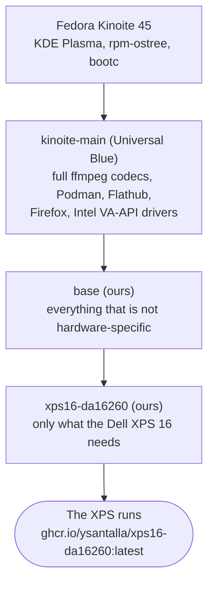
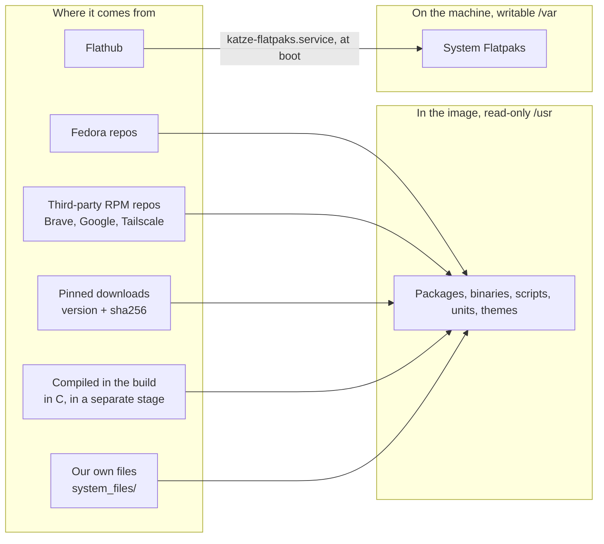
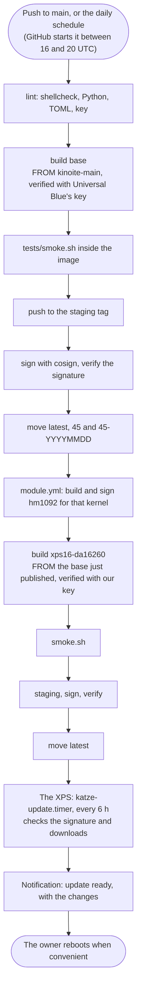
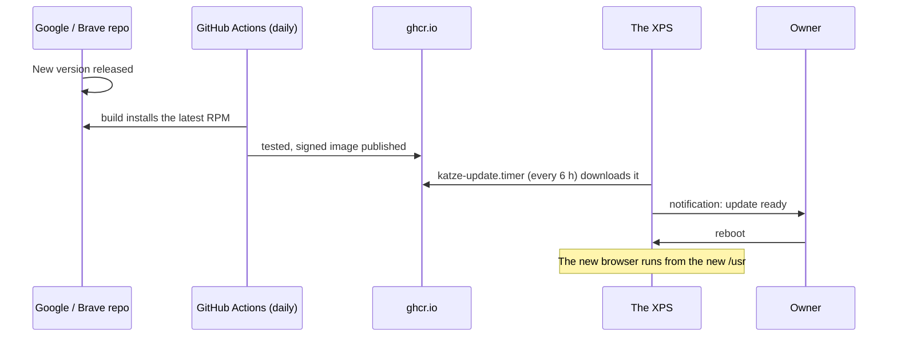
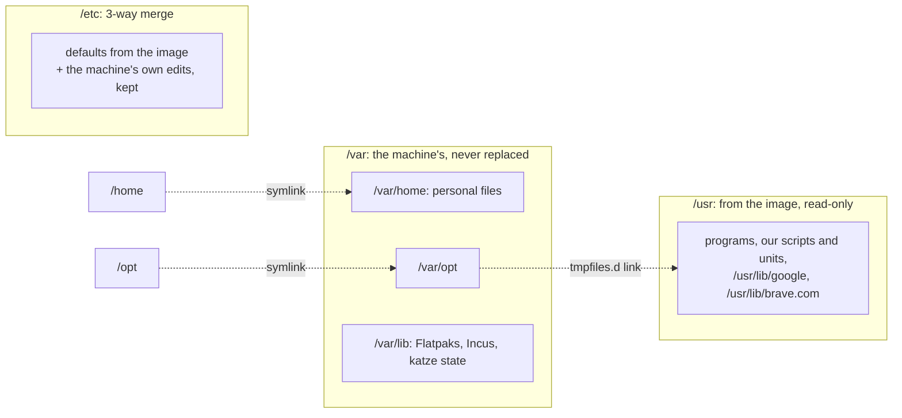
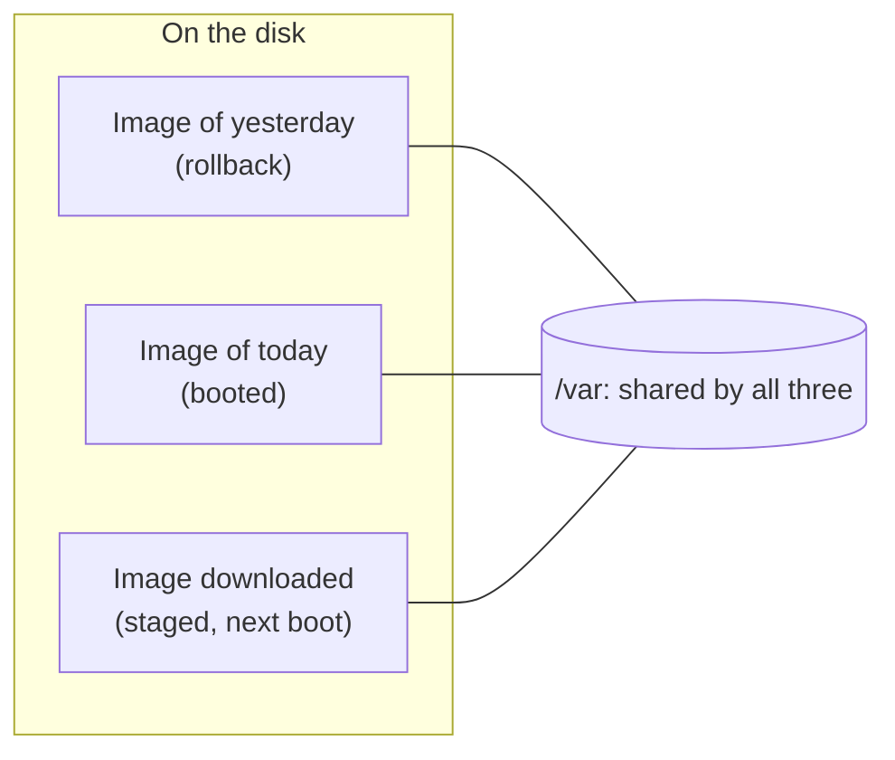

# How Katze OS works

The whole system on one page, with diagrams: what is installed and where it comes from, how a change reaches the machine, how the browsers update, and what the terms mean. It was written on 2026-11-26. `CLAUDE.md` has the details and the rules, `README.md` the steps, and `docs/status/` what was tested.

---

## 1. Three layers

Each image is built on top of the one before. A machine runs only the last one.

- `base` never has anything hardware-specific. A second machine would get its own image on top of `base`, next to the XPS one.
- The Fedora version is pinned (`FEDORA_VERSION=45`). Moving to 46 is a deliberate change in four files (`CLAUDE.md`, section 5).

---

## 2. What is installed, and where it comes from

### Fedora packages we add (`packages.txt`)

| Image | Purpose | Packages |
|---|---|---|
| base | Containers and VMs | `incus`, `qemu-system-x86-core`, `qemu-device-display-virtio-vga`, `virtiofsd`, `gdisk` |
| base | Docker commands on Podman | `podman-docker`, `docker-compose` |
| base | Terminal | `zsh`, `zsh-autosuggestions`, `zsh-syntax-highlighting`, `yakuake`, `fastfetch`, `nvtop` |
| base | Applications | `okular`, `kcalc`, `koko`, `haruna` |
| base | Fonts | `rsms-inter-fonts`, `google-carlito-fonts`, `google-crosextra-caladea-fonts` |
| XPS | Hardware video | `libva-intel-media-driver`, `libva-utils` |
| XPS | Measuring | `powertop`, `lm_sensors`, `igt-gpu-tools` (`gputop`), `kernel-tools` (`turbostat`) |
| XPS | Internal camera | `python3-gobject-base`, `gstreamer1-plugins-bad-free`, `libcamera-gstreamer`, `pipewire-gstreamer` |
| XPS | Dictation | `intel-npu-driver`, `intel-opencl`, `ydotool` |

### From outside Fedora

| What | How | Where |
|---|---|---|
| Brave Origin | Brave's RPM repo, disabled after the build | `brave.sh` |
| Google Chrome | Google's RPM repo, disabled after the build | `chrome.sh` |
| Tailscale | Tailscale's RPM repo, disabled after the build | `tailscale.sh` |
| Starship, MesloLGS Nerd Font | GitHub release, pinned by version and sha256 | `shell.sh` |
| Voxtype, OpenVINO GenAI (XPS) | Pinned by version and sha256 | `dictation.sh` |
| YuNet and SFace face models (XPS) | opencv_zoo, pinned by commit and sha256 | `face/build.sh` |
| `ir-camera`, `katze-face` (XPS) | Our C, compiled in a stage of the Containerfile, so the image gets no compiler | `ir-camera/`, `face/` |
| `hm1092` driver (XPS) | Our trimmed driver, compiled and signed with the owner's MOK key in CI | `module.yml`, `hm1092/` |
| Zed, Slack, ONLYOFFICE, GNOME Network Displays | Flathub, installed by `katze-flatpaks.service` | `flatpaks.list` |

`pins.yml` opens an issue each Monday when a pinned download has a newer release.

### Taken out or turned off

- `toolbox` and `distrobox`: Incus replaces them.
- `rpm-ostreed-automatic.timer` and `uupd.timer`: there is one updater, ours.
- Fedora's global themes, so only Breeze's and Katze's are offered.
- Gwenview as the default image viewer, which is not in the image: Koko replaces it in `kde-mimeapps.list`.

### Our own services

| Unit | Runs | Does |
|---|---|---|
| `katze-setup.service` | each boot | `incus-admin` group with nobody in it, subuid and subgid ranges |
| `katze-flatpaks.service` | boot, when `flatpaks.list` changed | installs the listed Flatpaks, never removes |
| `katze-update.timer` | every 6 h | downloads a new image, never on battery or a metered connection, never reboots |
| `katze-update-notify` (user) | login, and when an update arrives | the notification with up to five changes and a Restart button |
| `katze-image-age.timer` (user) | daily | warns when the running image is over 14 days old |
| `katze-desktop-entries.service` (user) | login | Slack and ONLYOFFICE launchers with the owner's arguments |
| `katze-icons.service` (user) | login | Katze Mono icons for the user's own applications |
| `katze-camera.service` (user, XPS) | login | the internal camera as one PipeWire camera |
| `katze-ir-camera.socket`, `katze-face.socket` (XPS) | on request | infrared frames for root, face check for the lock screen |
| `katze-dictation`, `katze-ydotoold` (user, XPS) | login | dictation with Meta+H |

---

## 3. From a commit to the machine

- A failed lint, build, test or signature stops everything before `latest` moves, so nothing reaches the machine.
- A pull request runs the same build and tests, but pushes and signs nothing.
- Only the layers that changed are downloaded, because `base` is **rechunked** (glossary).

---

## 4. How Chrome and Brave update

The browsers cannot update themselves: they live in `/usr`, which is read-only, and their repos are turned off on the machine (`enabled=0` in `/etc/yum.repos.d/`). Their daily cron jobs (`/etc/cron.daily/google-chrome`, `brave-origin`) never run, since the image has no cron.

They update **with the image** instead:

- **How long:** a release reaches the image in the next daily build (up to about a day), the machine downloads it within 6 hours, and it runs after the next reboot. Without a reboot the old version keeps running, and after 14 days a warning says so.
- **An urgent fix** (a security release) can come sooner: `gh workflow run build.yml` builds now, then `sudo bootc upgrade && systemctl reboot` on the machine.
- **Profiles, bookmarks and extensions** live in the home directory, so they are untouched by an update or a rollback.
- **A broken release** is undone with `sudo bootc rollback`, which brings back the previous browser with the previous image.

Everything else from RPMs (Fedora packages, Tailscale, the kernel) updates the same way. Flatpaks are the exception: upstream's `flatpak-system-update.timer` updates them on the machine, without a reboot.

---

## 5. The filesystem

| Path | On an update | Use |
|---|---|---|
| `/usr` | replaced by the new image | everything the image installs |
| `/etc` | the machine's edits stay, new defaults merge in | settings the machine may change |
| `/var` | never touched | personal files, Flatpaks, containers, state |

That is why the home directory shows as `/var/home/<user>`: the user was created with that path, and `/home` only points there. Since 2026-11-26 the owner's account is registered as `/home/yasmany`.

**The `/opt` workaround** (Chrome and Brave): their RPMs install into `/opt`, which is `/var/opt`, and the image never writes to `/var`. So the build installs into a temporary real `/opt`, moves the result to `/usr/lib/google` and `/usr/lib/brave.com`, and a `tmpfiles.d` line recreates `/var/opt/google -> /usr/lib/google` at boot.

---

## 6. Updates and rollback

- An update never changes the running system: it stages a new image beside it, which boots next time.
- `sudo bootc rollback` boots the previous image instead. Personal files are in `/var`, so they are the same in both.
- `sudo bootc status` shows the three.

---

## 7. Glossary

| Term | Meaning here |
|---|---|
| **bootc** | The tool that installs a container image as the whole operating system and updates it (`bootc upgrade`, `bootc rollback`, `bootc status`) |
| **OCI image** | The container image format. Each Katze image is one, stored on GHCR |
| **GHCR** | GitHub Container Registry, `ghcr.io/ysantalla/...`, where the images are published. Public |
| **Immutable / atomic** | `/usr` cannot be changed on the machine; a whole new image replaces it at once |
| **Deployment** | One image installed on the disk. Up to three: booted, staged, rollback |
| **Staged** | Downloaded and ready, used at the next boot |
| **Layering** | Installing packages on the machine with `rpm-ostree install`. Not done here: everything goes through the image |
| **Kinoite** | Fedora's atomic KDE edition |
| **Universal Blue, `kinoite-main`** | The project whose image we start from: Kinoite plus codecs and tools |
| **Containerfile** | The recipe of an image (a Dockerfile). Each image has one |
| **`build_files/`, `system_files/`** | Scripts that run only during the build, and files copied as they are into the image |
| **`packages.txt`** | The list of extra Fedora packages of an image |
| **Pinned** | Fixed to an exact version, checked by sha256, so the build cannot change silently |
| **sha256** | A fingerprint of a file; a different file gives a different one |
| **Rechunk** | Reorganizing `base` into about 200 layers by package, so an update downloads only the packages that changed |
| **Layer** | One part of an image. A machine downloads only the layers it does not have |
| **staging tag** | Where CI pushes an image before it is signed. Machines never follow it |
| **cosign** | The signing tool. CI signs each image; machines refuse an image from `ghcr.io/ysantalla` without our signature |
| **`policy.json`** | `/etc/containers/policy.json`, the machine's rule of which images need which signature |
| **Smoke test** | `tests/smoke.sh`: checks run inside a built image before it is published |
| **systemd unit, service, timer, socket** | Programs started by the system: at boot, on a schedule, or when something connects |
| **User unit** | A unit that runs for each user in their session, enabled with `systemctl --global` |
| **`tmpfiles.d`** | Rules that create files, folders and links at boot, used to put things in `/var` |
| **`sysusers.d`** | Rules that create system users and groups |
| **Flatpak** | Sandboxed applications from Flathub, installed in `/var`, updated on the machine |
| **Incus** | System containers and virtual machines; the devbox runs in it |
| **devbox** | One Incus container per project, with only that project's credentials (`docs/secrets-and-devbox.md`) |
| **Podman** | The container engine; `docker` commands run it |
| **firewalld zone, policy** | A zone sets what may reach the machine on an interface; a policy, what may pass between zones |
| **Tailscale, tailnet** | Private network between the owner's devices |
| **Secure Boot, MOK** | The firmware only boots signed code; a MOK is the owner's own key, enrolled so the firmware trusts the `hm1092` driver |
| **Kernel module** | A driver loaded into the kernel, like `hm1092` for the infrared camera |
| **PAM** | How Linux checks a login or an unlock; the lock screen's face check plugs in here |
| **PipeWire, WirePlumber** | The audio and camera system, and the part that decides which devices apps see |
| **libcamera, IPU7** | The library that drives the XPS's camera, and the Intel camera hardware |
| **VA-API** | Hardware video decoding and encoding, used by the browsers and Haruna |
| **NPU** | The processor's AI unit; dictation runs on it |
| **OpenVINO** | Intel's library for running AI models on the CPU, GPU or NPU |
| **tuned, `tuned-ppd`** | Power profiles; KDE's power slider picks our `katze-xps-*` ones |
| **RAPL, PL1, PL2** | Intel's power limits: the long-term and the short-term watts the processor may use |
| **VRR** | Variable refresh rate, which the XPS's panel supports and the kernel does not detect yet |
| **xe** | The kernel driver of the Arc B390 GPU |
| **mise** | The task runner of this repo (`mise run build base`), installed per user |
